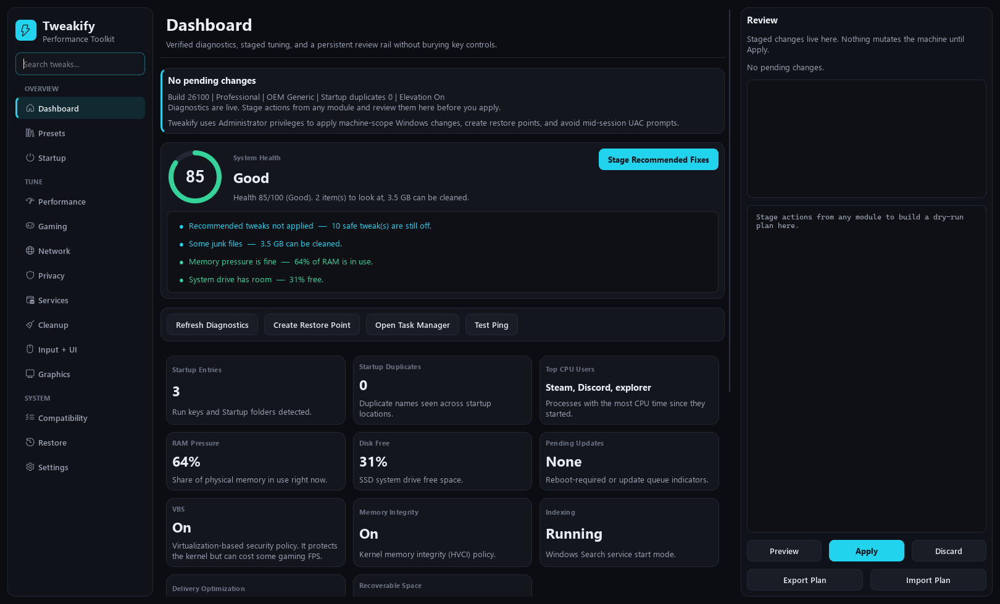
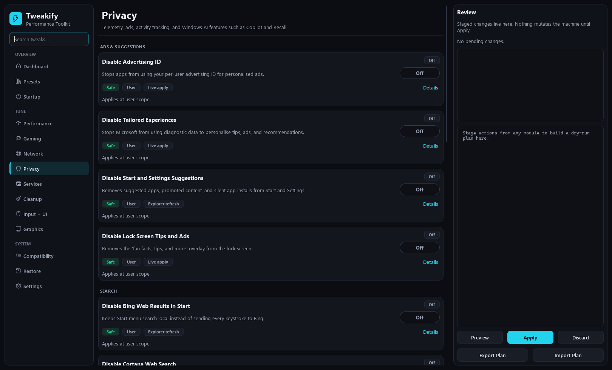
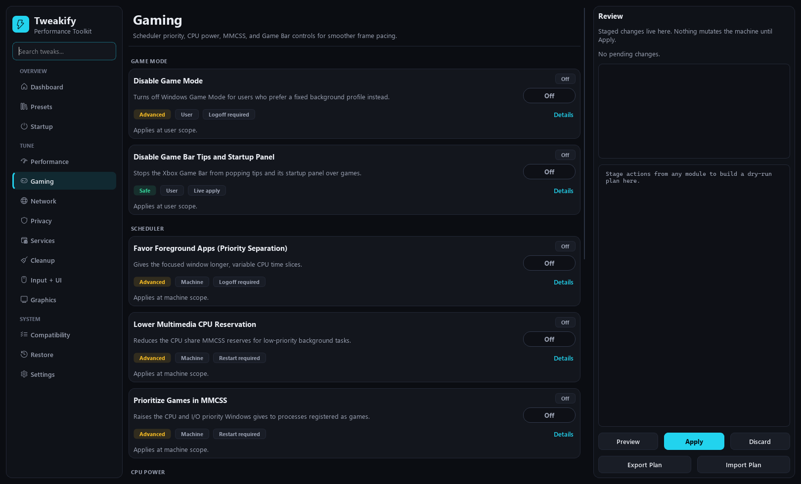
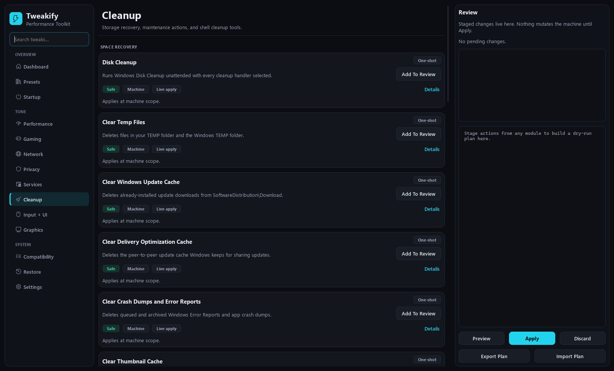
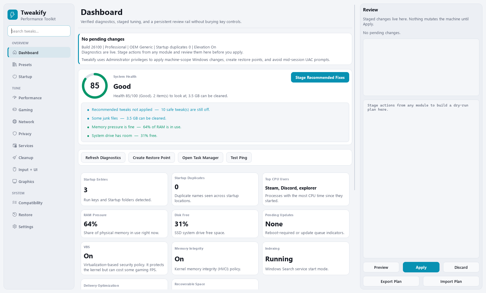

# Tweakify

[](https://github.com/XoreDev/Tweakify/releases/latest)


[](LICENSE)

**[Download the latest release](https://github.com/XoreDev/Tweakify/releases/latest)**

Open-source Windows optimizer with a staged review workflow. Every tweak shows exactly what it changes, why it may help, and what it costs. Nothing touches the machine until you press Apply, and every change is snapshotted so it can be rolled back.



Tweakify originally started as a small collaborative project, but was eventually abandoned. After three years, I revived and rebuilt it from the ground up, fixing major issues, improving stability, and turning it into a usable tool. It is now a functional, open-source Windows optimizer focused on performance, clarity, and transparency, so users can see exactly what they're running on their systems.

## What's New in 1.1

- **115 tweaks** across Startup, Performance, Gaming, Network, Privacy, Services, Cleanup, Input + UI, and Graphics (up from 63).
- **System health score** with explained findings, a recoverable-space scan, and one-click **Stage Recommended Fixes** (Safe tweaks only).
- **Privacy page**: Copilot, Recall, advertising ID, Start and lock screen ads, Bing in Start, activity history, typing data, Office telemetry.
- **Gaming page**: per-game High CPU/I/O priority, foreground priority, MMCSS, core parking, power throttling, C-states, forced-HPET removal.
- **Real NVIDIA driver settings** through NVIDIA Profile Inspector: power mode, V-Sync, low latency, refresh rate, texture filtering.
- **Repair and maintenance**: SFC, DISM, WinSxS cleanup, network reset, winget "update all apps", bloat app removal, weekly automatic cleanup.
- **Redesigned interface** with dark and light themes, sidebar search, plan export/import, and a command line for headless runs.
- **About 30 bug fixes**, including service tweaks that never applied, a temp cleaner that deleted nothing, and fake NVIDIA commands.

Full details: [CHANGELOG.md](CHANGELOG.md). The research behind the feature set, covering 44 paid, free, and community optimizers, is in [docs/competitive-research.md](docs/competitive-research.md).

## Screenshots

| Privacy | Gaming |
|---|---|
|  |  |
| **Cleanup and repair** | **Light theme** |
|  |  |

## How It Works

1. **Stage.** Flip tweaks on or off, pick a preset, or let the health check suggest fixes. Nothing changes yet.
2. **Review.** The review panel shows a dry run: every registry value, service, power setting, and command that will be touched.
3. **Apply.** Tweakify snapshots the current state of everything it changes, applies the plan, and verifies each result. Advanced changes also get a Windows restore point.
4. **Roll back.** Any applied snapshot can be restored from the Restore page, newest change first.

Safety tiers are color-coded: **Safe** tweaks are broadly agreed on, **Advanced** tweaks have real trade-offs, and **Experimental** tweaks are hidden unless you turn them on in Settings.

## Quick Start

### Portable release

1. Download `Tweakify-v1.1.0-portable.rar` from the [latest release](https://github.com/XoreDev/Tweakify/releases/latest) and extract it.
2. Run `install_requirements.bat`. It installs Python 3.13 with winget if needed, then PySide6.
3. Run `Tweakify.pyw`, or `py Tweakify.py` for a console window.

### From source

```powershell
python -m pip install -r requirements.txt
python .\Tweakify.py
```

## Administrator Access

Tweakify asks for Administrator rights at launch, so machine-wide changes, restore points, and service changes run without mid-session UAC prompts. If you decline, it keeps running without elevation and hands machine-scope changes to an elevated helper when you apply.

## Command Line

```powershell
py .\Tweakify.py --apply-plan .\my-plan.json          # apply a plan exported from the Review panel
py .\Tweakify.py --rollback-snapshot snap-1234abcd    # undo a recorded apply
py .\Tweakify.py --run-actions clear_temp_files,flush_dns_cache
```

Each command prints one line per action and exits non-zero if any action failed. The weekly cleanup task uses `--run-actions`.

## Repository Layout

```text
app/actions/              tweak catalog, one module per page
app/domain/               models, presets, compatibility rules, health score
app/platform/             Windows adapter (registry, services, powercfg, PowerShell) and an in-memory test double
app/ui/                   PySide6 window and design system
tests/                    pytest suite (130 tests)
tools/build_portable.py   portable bundle builder
docs/                     research notes and screenshots
```

## Development

```powershell
python -m pip install -r requirements-dev.txt
python -m pytest
python .\tools\build_portable.py    # builds .\TweakifyPortable
```

The project targets Python 3.13+ and PySide6. The test suite runs against an in-memory platform, so it never changes the machine running it.

## License

[MIT](LICENSE)
